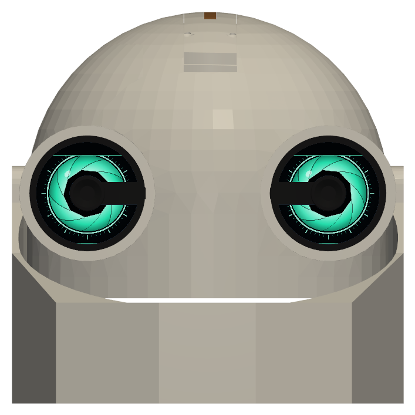
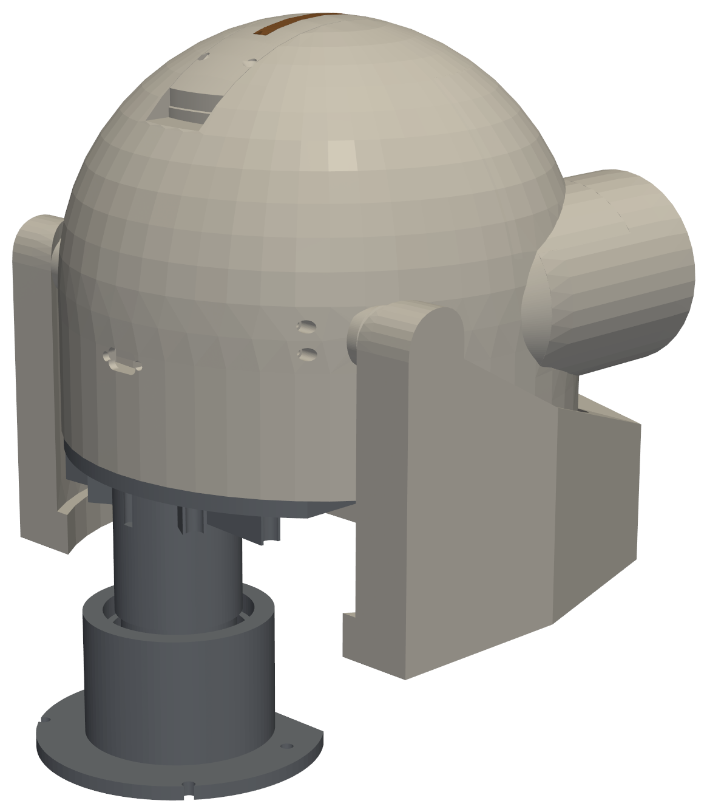
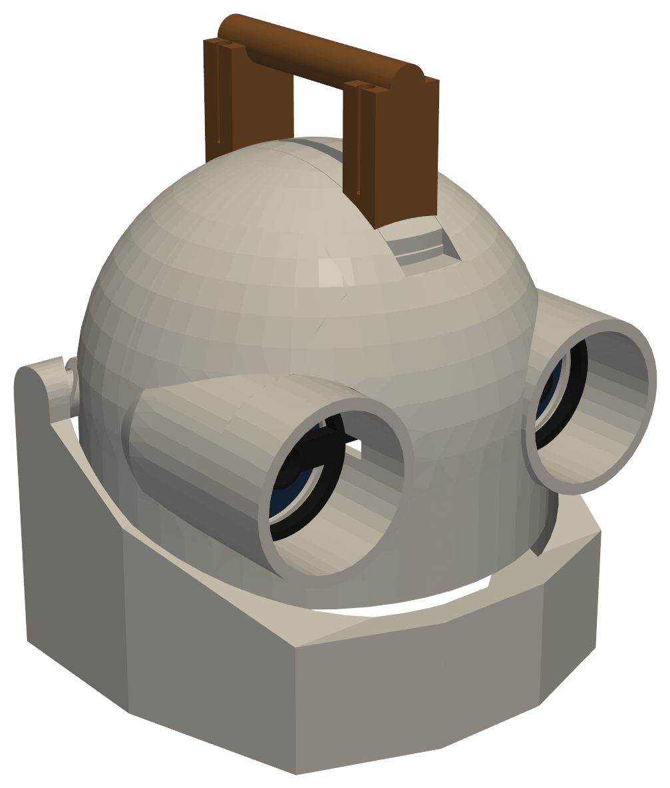

# Gene 1.0 — Robot Head

[](https://buymeacoffee.com/YOUR_BMC_USERNAME)

Gene is a 3D-printed, expressive robot head. It has two round LCD eyes with cameras for pupils, a talking jaw driven by twin DYNAMIXEL servos, a Raspberry Pi 5 brain with stereo speakers, an onboard 2S Li-ion pack, and a slip-ring neck so the head can turn without winding up its cables.

<p align="center">
  
  
  
</p>

Every printed part was fit-checked against every other part and the bought electronics with exact solid intersection, and the jaw was swept through its full travel. The full record is in [`docs/DESIGN_NOTES.md`](docs/DESIGN_NOTES.md).

## Features

- **Eyes:** 2 × 2.1" round 480×480 LCDs (mini-HDMI driver boards), in glued-in carriers behind the eye barrels
- **Pupils:** an Arducam mini OV5647 camera at the centre of each eye, in a black bezel, for stereo vision (121.9 mm baseline)
- **Jaw:** twin ROBOTIS XL330-M288-T servos run in tandem on a D-shaft jaw (speaking range 0–30°)
- **Brain:** Raspberry Pi 5 on a shelf under the eyes, with an I2S amp and two 28 mm speakers
- **Power:** 2S2P 18650 pack (43–50 Wh) with BMS, charger and two 5 V 5 A converters, about 3 h runtime
- **Crown:** GPIO bay in the top of the head, with an optional bridge handle, an optional GPIO flashlight, or a plain cover
- **Neck:** bearing-mounted tube with a slip ring, so the head turns continuously; the base bolts to any body or stand

## Repository layout

```
Gene 1.0/
├── print/                  Print-ready files: start here to build one
│   ├── PRINT_LIST.md       Every piece, quantity, plate and print settings, with a checklist
│   ├── parts/              One oriented STL per part (01_skull ... 19_gpio_cover)
│   └── plates/             Build plates as .3mf, each fits a 250 x 250 mm bed
├── docs/
│   ├── BOM.md / BOM.csv    Printed parts, hardware, electronics, power and cables
│   ├── DESIGN_NOTES.md     Assembly order, software limits, verification and full design history
│   ├── WIRING.md           Wiring diagrams: audio (Pi, amp, speakers) and power (pack, BMS, charger, bucks)
│   └── images/             Renders
├── cad/                    Model sources in the head frame (see cad/README.md)
│   ├── *.stl               Current parts, one file per part (skull.stl, jaw.stl, ...)
│   ├── mocks/              Fit-check stand-ins for the bought parts (not printed)
│   └── tools/              Python scripts that build, check and export the parts and the sim
├── sim/
│   └── head_sim.html       Self-contained interactive sim: open it in a browser
└── software/
    └── pi/                 Raspberry Pi audio config and volume control
        └── gene/           Gene's Pi software: voice, eyes, cameras, memory, self-upgrades, web control panel
```

## Build it

1. **Print:** follow [`print/PRINT_LIST.md`](print/PRINT_LIST.md). Load the plates from `print/plates/` straight into your slicer. Print the camera bezels and pupil rings in black. Use PETG for the battery tray, deck, servo brackets and flashlight; PLA or PETG is fine for everything else. Plan on about 1.3 kg of filament.
2. **Buy:** order the hardware, electronics and power parts listed in [`docs/BOM.md`](docs/BOM.md). Items marked **(assumed)** were fit-checked against a placeholder of the stated size, so check your actual part.
3. **Assemble:** follow the assembly order in [`docs/DESIGN_NOTES.md`](docs/DESIGN_NOTES.md): eyes, cameras, battery unit, jaw drive, Pi, crown, jaw, neck. Wire it up from [`docs/WIRING.md`](docs/WIRING.md).
4. **Set the limits in software:**

   | | |
   |---|---|
   | Jaw speaking range | 0–30° |
   | Jaw servo limit, neck fitted | **33°** (the chin reaches the neck base at 35.5°) |
   | Jaw servo limit, no neck | 50° (first skull contact at 53.25°) |
   | Twin XL330s | one of the pair **reversed** (Drive Mode bit or negated angle) |
   | Pi 5 powered through GPIO 5 V | `usb_max_current_enable=1` in `config.txt` |
   | Eye displays | mounted **turned 180°** (LCD ribbon up, plugs down), so rotate both outputs 180° on the Pi |

## Simulator

Open [`sim/head_sim.html`](sim/head_sim.html) in a browser. You don't need a server or an install. It shows every part in place. You can sweep the jaw, turn the head, run the eye expressions, preview the two camera views, and cut a section to look inside.

## Status

Designed, fit-checked, and partly printed. Still open:

- A hole in the skull for the power switch (the USB-C charge port is cut in the lower back)
- Micro-USB power leads for the display driver boards
- A motor to drive the neck rotation
- The body or stand the neck base bolts to (4 × M4 on a 76 × 45 mm rectangle)

## Regenerating files

The scripts in `cad/tools/` rebuild the parts, run the interference checks and re-export the print files and the sim. Setup and the build order are in [`cad/README.md`](cad/README.md).

## Support

If Gene helped you or you just like the project, you can support its development on Buy Me a Coffee:

<a href="https://buymeacoffee.com/YOUR_BMC_USERNAME"></a>

## Credits

- `cad/mocks/xl330_servo.stl` is converted from ROBOTIS's published STEP model of the DYNAMIXEL XL330-M288-T. It is used only to draw the servos in the sim.
