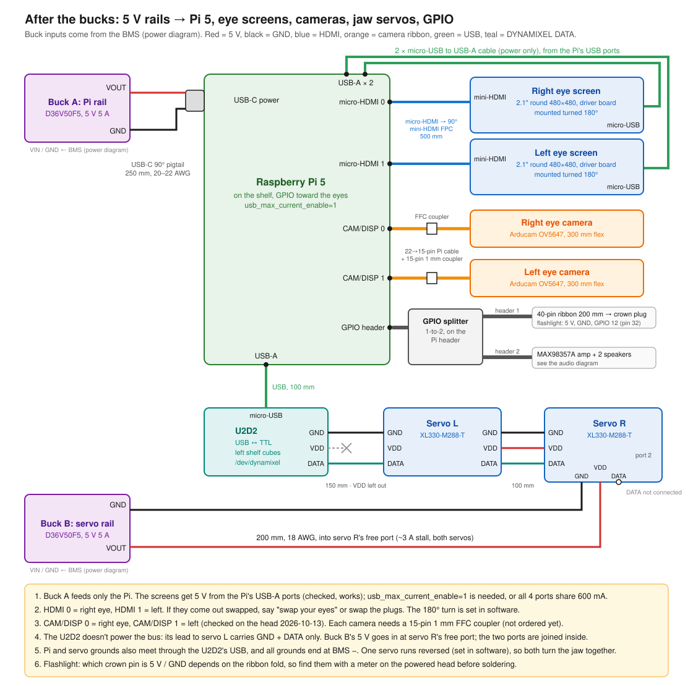

# Wiring

Four diagrams: the audio chain (Pi 5 → I2S amp → speakers), the power stack (pack → BMS → switch → bucks, with USB-C charging), what hangs off the two bucks, and building the pack. Cable lengths to buy are in [`BOM.md`](BOM.md) section 5.

## Audio: Pi 5, MAX98357A, speakers

| MAX98357A | Pi 5 header (2nd header on the splitter) | Notes |
|---|---|---|
| Vin | pin 4 (5 V) | |
| GND | pin 6 (GND) | Any GND pin works |
| BCLK | pin 12 (GPIO 18, PCM CLK) | |
| LRC | pin 35 (GPIO 19, PCM FS) | |
| DIN | pin 40 (GPIO 21, PCM DOUT) | |
| GAIN | not connected | Open = 9 dB |
| SD | not connected | Adafruit board: 1 MΩ pull-up gives the (L+R)/2 mono mix. Clone with no pull-up: add 1 MΩ SD → Vin |
| Speaker + / − | Both speakers in parallel (+ to +, − to −) | 2 × 8 Ω = 4 Ω. Bridged output: never connect a speaker wire to GND |

Pi setup: `dtparam=i2s=on` and `dtoverlay=hifiberry-dac` in `/boot/firmware/config.txt`, then copy [`software/pi/asound.conf`](../software/pi/asound.conf) to `/etc/asound.conf`.

The amp takes its 5 V from the Pi header, so the only cable it needs is the one to the splitter that's already routed. GPIO 12 (pin 32) stays free for the crown flashlight.

## Power: battery, BMS, charger, bucks

| From | To | Wire |
|---|---|---|
| Pack B+ / BM / B− | BMS **8.4V** / **4.2V** / **0V** (XT30 for B+/B−, JST-XH balance lead for BM). Solder 0V first, then 4.2V, then 8.4V | 18 AWG main, balance lead as supplied |
| USB-C charge port (panel-mount extension, lower back of skull) | Charger board's USB-C socket | The extension's right-angle male end plugs straight in, so there's nothing to solder. Leave the charger's **VIN / GND** pads empty: they're the same 5 V input |
| Charger **BAT** / **GND** (the GND next to BAT) | BMS **+** / **−** | 18–22 AWG |
| BMS **+** | Switch (2-wire, no ground) → fuse (recommended, 10 A) → VIN of both bucks | 18 AWG |
| BMS **−** | GND of both bucks | 18 AWG |
| Buck A (Pi rail) VOUT / GND | Pi 5 USB-C pigtail (the eye screens are powered from the Pi's USB-A ports) | Pi lead 20–22 AWG |
| Buck B (servo rail) VOUT / GND | XL330 VDD / GND, fed in at servo R | 18 AWG |

- The charger connects after the BMS and before the switch, so the pack charges with Gene switched off and the BMS still protects it.
- Pad names on the boards actually bought (Amazon, 2026-09-30). BMS, 2S 20 A with balance: **0V** = B−, **4.2V** = BM, **8.4V** = B+, **+** = P+, **−** = P−. Charger, Adeept 2S 2A USB-C boost: **VIN / GND** = 5 V in (unused), **BAT / GND** = 8.4 V out.
- Before connecting the charger, plug in USB-C and meter BAT to GND: about 8.4 V is right (0 V can mean it waits for a battery). About 4.2 V means a 1S board, so don't use it.
- The D36V50F5 is a fixed 5 V part with no trim pot. Leave EN and PG unconnected.
- The Pi gets 5 V without USB-PD, so add `usb_max_current_enable=1` to `config.txt`, or its USB ports are capped at 600 mA.
- The U2D2 doesn't power the DYNAMIXEL bus. Its lead to servo L carries DATA and GND. Power from Buck B goes in at servo R.
- All grounds meet at BMS −. The Pi and servo grounds are also joined through the U2D2's USB lead.
- Before connecting anything, power the bucks with no loads and check for 5.0 V and the right polarity with a meter.

## After the bucks: Pi 5, eye screens, cameras, servos, GPIO

| From | To | Cable |
|---|---|---|
| Buck A VOUT / GND | Pi 5 USB-C | USB-C 90° pigtail 250 mm |
| Pi USB-A × 2 | Right / left eye screen micro-USB (power) | micro-USB to USB-A cable. Needs `usb_max_current_enable=1`; checked on the head and it works |
| Pi micro-HDMI 0 / 1 | Right / left eye screen mini-HDMI | micro-HDMI to 90° mini-HDMI FPC, 500 mm |
| Pi CAM/DISP 0 / 1 | Right / left eye camera | 22-to-15-pin Pi cable + 15-pin 1 mm FFC coupler + the Arducam's 300 mm flex |
| Pi USB-A | U2D2 micro-USB | 100 mm |
| U2D2 TTL (GND, DATA) | Servo L | 150 mm DYNAMIXEL lead with VDD left out |
| Servo L | Servo R | 100 mm DYNAMIXEL lead, all 3 wires |
| Buck B VOUT / GND | Servo R's free port (VDD, GND; DATA not connected) | 200 mm, 18 AWG |
| Pi GPIO header | 1-to-2 splitter: header 1 to the crown ribbon (flashlight), header 2 to the amp | see the audio diagram |

- Cameras: CAM/DISP 0 is the right eye and CAM/DISP 1 the left, as checked on the head (2026-10-13). The cable table in `BOM.md` has them the other way round.
- Each XL330's two ports are joined inside, so feeding 5 V into servo R's free port is the same as splicing it into the L-to-R lead.

## Battery pack: building the 2S2P

Four 18650s sit side by side in the tray. A and B face + forward and C and D face + rearward, so one front nickel strip (S1) does three jobs: it joins A∥B, joins C∥D, and makes the series link (BM). The rear strips are S2 (A−/B−, pack B−) and S3 (C+/D+, pack B+), with a gap between them that must never be bridged. The diagram lists all 13 connections, the plug pinouts, the meter checks and the build order.

## Secondary setup: bought power bank instead of the 2S2P pack

A bought power bank can replace the pack, the BMS and the charger board. The bank fitted for is the **INIU Pocket Rocket P50** (10000 mAh, 45 W, 83.6 x 53.1 x 25.4 mm). It lies across the head in its own tray (`21_battery_tray_POWERBANK_x1.stl`), with its ports at Gene's left (+X) end. One USB-C output goes into a **15 V USB-C PD trigger board**. From the trigger's output onwards the wiring is the same as the pack's: switch, fuse, both D36V50F5 bucks, then everything in the loads diagram.

| From | To | Wire |
|---|---|---|
| USB-C charge port extension (right-angle male) | The bank's in/out USB-C (the port that charges the bank) | as supplied. Routed 108 mm, so the 30 cm lead has plenty of slack |
| The bank's other USB-C | PD trigger board set to **15 V** (USB-C male plug, or a short right-angle C-to-C cable into a board with a socket) | routed 72 mm; buy 150 mm |
| Trigger **V+** | Switch (2-wire) → fuse (5 A) → VIN of both bucks | 18 AWG |
| Trigger **GND** | GND of both bucks | 18 AWG |
| Buck A / Buck B outputs | Pi 5 USB-C / servo R, as in the power table above | Pi lead 200 mm, servo lead 150 mm (the bucks sit closer than on the pack deck) |

- **Not needed:** 18650 cells, nickel strip, BMS, charger board, XT30, balance lead, and the two pack straps.
- Don't use the bank's USB-A port, and don't use both USB-C outputs at once. With two outputs in use the P50 drops to 15 W in total. One USB-C output on its own gives up to 45 W (15 V 3 A), and Gene's 36 W peak is 2.4 A at 15 V.
- Before connecting anything, plug the trigger into the bank and meter V+ to GND. You should see 15 V. If you see 5 V, the trigger didn't negotiate: check its setting.
- **Pass-through:** the P50 runs Gene while it charges, but reviews report a short drop in its output when the charger is plugged in or pulled out. That reboots the Pi, so plug and unplug the charger with Gene switched off.
- **Bench test, needed before this is final:** switch Gene off for a few minutes, then switch on again. If the bank has gone to sleep and gives no output, the switch has to open the USB-C link itself. In that case use an inline USB-C switch cable that breaks VBUS and CC between the bank and the trigger, so turning it on looks like a fresh plug-in.
- Runtime is about 2 h talking: about 37 Wh in the bank, less its own conversion loss. The pack gives about 3 h.
- The bank's button and display end up inside the head. To check its charge, read it on the bench, or let the Pi warn you when 5 V sags.

Not covered yet: the slip ring's fixed-side wires below the neck base, and where the power switch goes in the skull.
