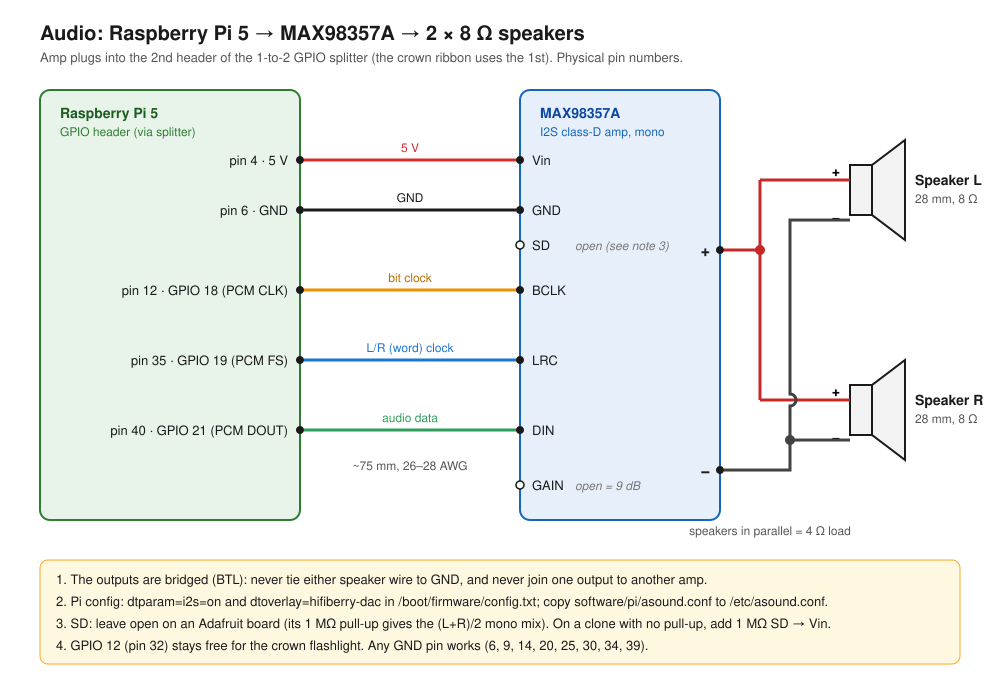
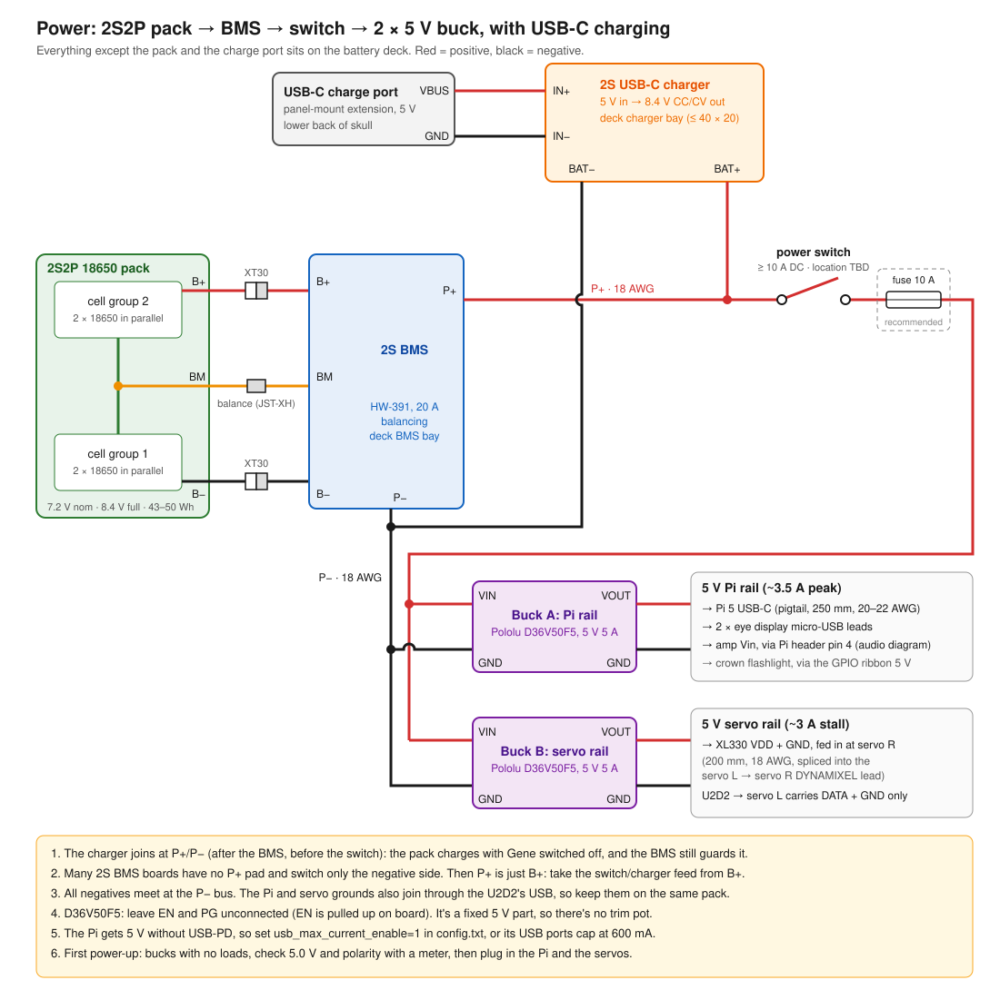
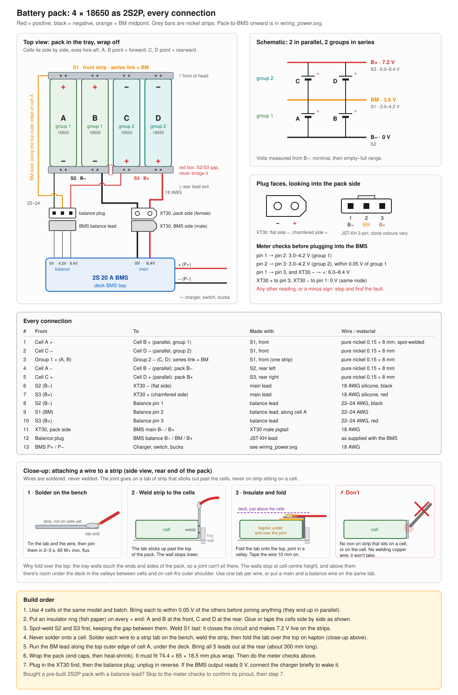

# Wiring

Two diagrams: the audio chain (Pi 5 → I2S amp → speakers) and the power stack (pack → BMS → switch → bucks, with USB-C charging). Cable lengths to buy are in [`BOM.md`](BOM.md) section 5.

## Audio: Pi 5, MAX98357A, speakers

| MAX98357A | Pi 5 header (2nd header on the splitter) | Notes |
|---|---|---|
| Vin | pin 4 (5 V) | |
| GND | pin 6 (GND) | Any GND pin works |
| BCLK | pin 12 (GPIO 18, PCM CLK) | |
| LRC | pin 35 (GPIO 19, PCM FS) | |
| DIN | pin 40 (GPIO 21, PCM DOUT) | |
| GAIN | not connected | Open = 9 dB |
| SD | not connected | Adafruit board: 1 MΩ pull-up gives the (L+R)/2 mono mix. Clone with no pull-up: add 1 MΩ SD → Vin |
| Speaker + / − | Both speakers in parallel (+ to +, − to −) | 2 × 8 Ω = 4 Ω. Bridged output: never connect a speaker wire to GND |

Pi setup: `dtparam=i2s=on` and `dtoverlay=hifiberry-dac` in `/boot/firmware/config.txt`, then copy [`software/pi/asound.conf`](../software/pi/asound.conf) to `/etc/asound.conf`.

The amp takes its 5 V from the Pi header, so the only cable it needs is the one to the splitter that's already routed. GPIO 12 (pin 32) stays free for the crown flashlight.

## Power: battery, BMS, charger, bucks

| From | To | Wire |
|---|---|---|
| Pack B+ / BM / B− | BMS **8.4V** / **4.2V** / **0V** (XT30 for B+/B−, JST-XH balance lead for BM). Solder 0V first, then 4.2V, then 8.4V | 18 AWG main, balance lead as supplied |
| USB-C charge port (panel-mount extension, lower back of skull) | Charger board's USB-C socket | The extension's right-angle male end plugs straight in, so there's nothing to solder. Leave the charger's **VIN / GND** pads empty: they're the same 5 V input |
| Charger **BAT** / **GND** (the GND next to BAT) | BMS **+** / **−** | 18–22 AWG |
| BMS **+** | Switch (2-wire, no ground) → fuse (recommended, 10 A) → VIN of both bucks | 18 AWG |
| BMS **−** | GND of both bucks | 18 AWG |
| Buck A (Pi rail) VOUT / GND | Pi 5 USB-C pigtail, both display micro-USB leads | Pi lead 20–22 AWG |
| Buck B (servo rail) VOUT / GND | XL330 VDD / GND, fed in at servo R | 18 AWG |

- The charger connects after the BMS and before the switch, so the pack charges with Gene switched off and the BMS still protects it.
- Pad names on the boards actually bought (Amazon, 2026-09-30). BMS, 2S 20 A with balance: **0V** = B−, **4.2V** = BM, **8.4V** = B+, **+** = P+, **−** = P−. Charger, Adeept 2S 2A USB-C boost: **VIN / GND** = 5 V in (unused), **BAT / GND** = 8.4 V out.
- Before connecting the charger, plug in USB-C and meter BAT to GND: about 8.4 V is right (0 V can mean it waits for a battery). About 4.2 V means a 1S board, so don't use it.
- The D36V50F5 is a fixed 5 V part with no trim pot. Leave EN and PG unconnected.
- The Pi gets 5 V without USB-PD, so add `usb_max_current_enable=1` to `config.txt`, or its USB ports are capped at 600 mA.
- The U2D2 doesn't power the DYNAMIXEL bus. Its lead to servo L carries DATA and GND. Power from Buck B goes in at servo R.
- All grounds meet at BMS −. The Pi and servo grounds are also joined through the U2D2's USB lead.
- Before connecting anything, power the bucks with no loads and check for 5.0 V and the right polarity with a meter.

## Battery pack: building the 2S2P

Four 18650s sit side by side in the tray. A and B face + forward and C and D face + rearward, so one front nickel strip (S1) does three jobs: it joins A∥B, joins C∥D, and makes the series link (BM). The rear strips are S2 (A−/B−, pack B−) and S3 (C+/D+, pack B+), with a gap between them that must never be bridged. The diagram lists all 13 connections, the plug pinouts, the meter checks and the build order.

Not covered yet: the slip ring's fixed-side wires below the neck base, and where the power switch goes in the skull.
